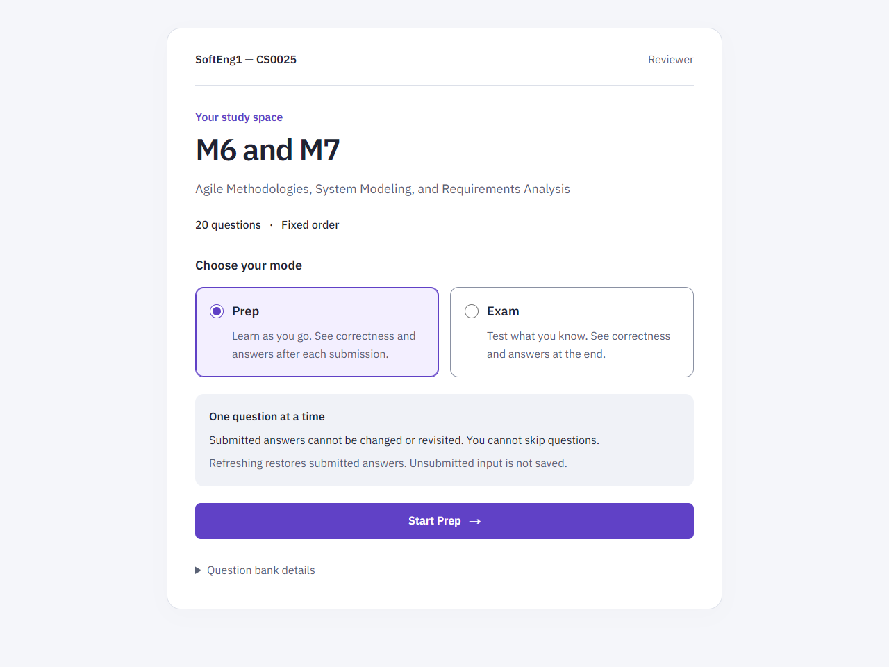
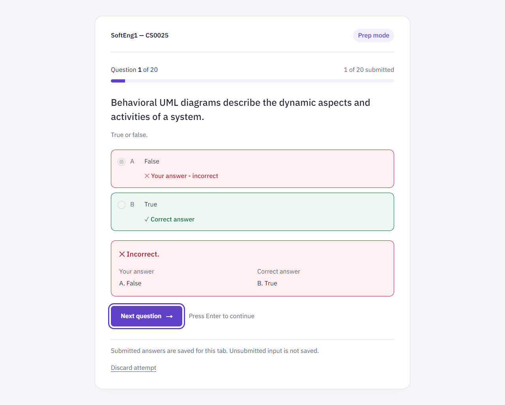
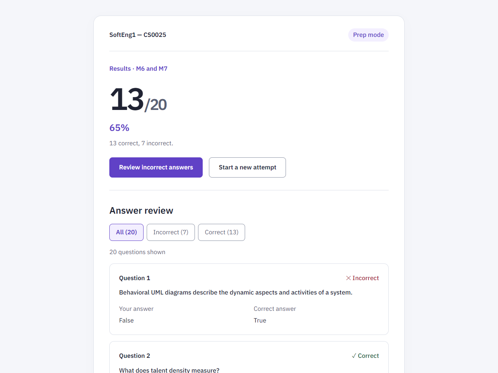

# Exam Reviewer

A browser-based reviewer for **SoftEng1 (CS0025), M6 and M7**. Practice 20 questions on agile methodologies, system modeling, and requirements analysis, with a choice of immediate feedback or an exam-style attempt.

Built with Next.js, React, and TypeScript. The app runs in the browser and exports as a static site.



[View the 375px mobile layout](screenshots/start-mobile.png)

## Review modes

| Mode | After each submission | At the end |
| --- | --- | --- |
| Prep | Shows whether your answer is correct and displays the correct answer(s). | Score, percentage, and a full answer review. |
| Exam | Confirms that your answer is locked; hides correctness. | Score, percentage, and a full answer review. |

Choose **Prep** (selected by default) or **Exam**, then use **Start Prep** or **Start Exam**. The source label is available under **Question bank details**.

Questions appear one at a time in a fixed order. Choose or enter an answer, select **Submit answer**, then continue with **Next question**. Submitted answers stay locked: you cannot edit them, return to earlier questions, or skip ahead. The final question leads to **See results**.

The continuous progress bar counts submitted answers; it is not question navigation. Browser Back works normally and leaves the reviewer without reopening earlier questions.

Results include **All**, **Incorrect**, and **Correct** filters with counts, preserving original question numbers and order. **Review incorrect answers** opens and focuses the incorrect-answer review when mistakes exist. Empty filters explain that no answers match. Restarting returns to mode selection.

An attempt saves to `sessionStorage`, so refreshing restores the current question and submitted answers when browser storage is available. Unsubmitted input is not saved. Use **Discard attempt** to clear progress and return to mode selection, or **Start a new attempt** after reviewing results.





## Run locally

Requires **Node.js 22.18 or newer** and npm.

```sh
npm ci
npm run dev
```

Open [localhost:3000](http://localhost:3000). No environment variables or backend services are required for local development.

### Commands

| Command | Purpose |
| --- | --- |
| `npm run dev` | Start the development server. |
| `npm test` | Run grading and question-bank tests with Node's built-in test runner. |
| `npm run lint` | Check TypeScript types with `tsc --noEmit`. |
| `npm run build` | Generate the static production site in `out/`. |
| `npx serve out` | Preview the static build locally after building. |

The project uses static export; preview production output with `npx serve out`. The `npm start` script uses `next start`, which does not support this output mode.

IBM Plex Sans is configured through `next/font/google`. Builds need internet access to download the fonts; the generated site serves them locally.

## Question bank and grading

[data/questions.json](data/questions.json) contains the bank metadata, questions, and answer key. The included bank retains the source label `[M3-SUMMATIVE] [AI-Prohibited]`.

| Question type | Grading rule |
| --- | --- |
| `single` / `truefalse` | Select the correct choice. |
| `multi` | Select every correct choice and no incorrect choices. No partial credit. |
| `fill` | Match an entry in `acceptedAnswers` after trimming, collapsing whitespace, and converting to uppercase. |

Submit becomes available after selecting one choice, selecting at least one option for a multi-select question, or entering non-empty text. Each correct question earns one point.

To edit the bank, update `data/questions.json` using the types in [src/lib/types.ts](src/lib/types.ts). Keep question and choice IDs unique, align `questionCount` with the question list, and update the bank-specific assertions in [tests/grade.test.ts](tests/grade.test.ts). Run the tests and type check before building.

## Project layout

```text
data/questions.json          Question bank and answer key
src/app/                     Page entry, layout, fonts, and styles
src/components/              Mode selection, question player, and results
src/lib/bank.ts              Question-bank import
src/lib/types.ts             Question and answer types
src/lib/grade.ts             Answer validation, grading, and scoring
src/lib/attempt.ts           Attempt progression and session storage
tests/grade.test.ts         Grading and bank tests
screenshots/                 UI screenshots
.github/workflows/nextjs.yml  GitHub Pages build and deployment
```

## Deployment

The repository includes a [GitHub Pages workflow](.github/workflows/nextjs.yml) that runs on pushes to `main` and manual dispatches. It installs dependencies, runs tests and the TypeScript check, builds the static site, and deploys `out/`.

Set the repository's **Settings > Pages > Source** to **GitHub Actions**. The workflow passes the Pages base path through `NEXT_PUBLIC_BASE_PATH`, so assets resolve under the repository's URL path. Local builds default to the root path.

## Scope

This version includes one question bank and stores attempts in the current browser tab's session. It has no sign-in, database, file uploads, or calendar sync.

Grading happens in the browser, and the answer key ships with the site. Use it as a personal study tool; it provides no protection against inspecting or modifying answers.
